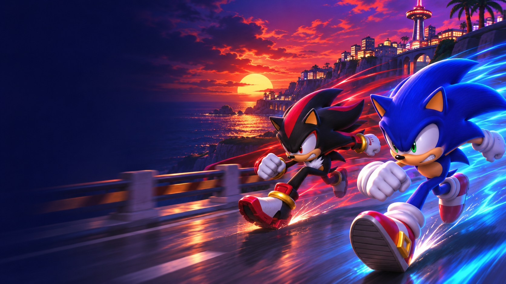

  

<h1 align="center">ChaosControl 2: Battle</h1>

An unofficial PlayStation 5 homebrew port of the Xbox 360 edition of Sonic Adventure 2.

  <a href="https://github.com/BaZZtian/ChaosControl-2-Battle/releases">Download</a> · <a href="#before-you-install">Requirements</a> · <a href="#support">Help</a>

## Get the game

**No public PS5 build is available yet.** The [GitHub Releases page](https://github.com/BaZZtian/ChaosControl-2-Battle/releases) will carry the download and installation instructions when a build is ready. The [older BattleHeart store listing](https://prosperostore.net/app/PPSA99732/) is not a ChaosControl 2: Battle download.

## Before you install

- You’ll need a PS5 that can run homebrew and your own copy of **Sonic Adventure 2 for Xbox 360** (title ID `58411202`).
- Use your own **Battle** add-on data for Battle content. Check the release notes for supported firmware and game revisions.
- Game files and save data are not included in the download.

## Support

Use [GitHub Issues](https://github.com/BaZZtian/ChaosControl-2-Battle/issues) to report a problem. Include the ChaosControl version, your PS5 firmware, your game edition and the steps that reproduce the issue.

## Credits

ChaosControl 2: Battle is maintained by [BaZZtian](https://github.com/BaZZtian).

The Xbox 360 recompilation base comes from [sa2-nx](https://github.com/ChanseyIsTheBest/sa2-nx) by ChanseyIsTheBest and its contributors.

Thanks to the [ReXGlue SDK](https://github.com/rexglue/rexglue-sdk), [PS5 homebrew SDK](https://github.com/ps5-payload-dev/sdk), and [LLVM](https://github.com/llvm/llvm-project) contributors. Thanks also to [roeming](https://github.com/roeming/SA2B) and [nlopez99](https://github.com/nlopez99/SA2B) for earlier research references.

Sonic Adventure 2: Battle and its characters belong to SEGA and their respective rightsholders. This is an unofficial fan project. See [Credits and third-party licenses](THIRD_PARTY_NOTICES.md) for the PS5 build’s upstream code, the ChaosControl changes, and the applicable licenses.
